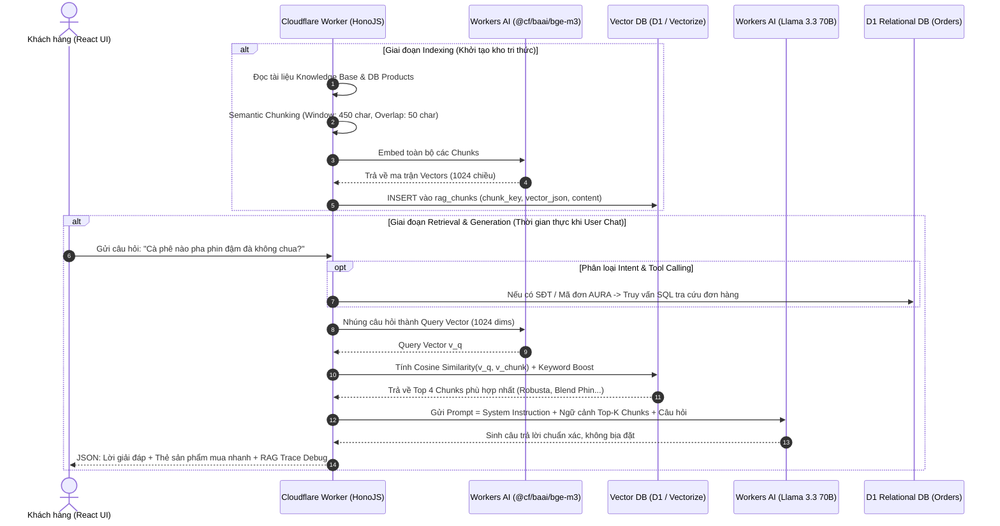

# BÁO CÁO KỸ THUẬT: NGHIÊN CỨU & XÂY DỰNG TRỢ LÝ BARISTA AI (RAG CHATBOT)
## HỆ THỐNG THƯƠNG MẠI ĐIỆN TỬ CÀ PHÊ ĐẶC SẢN AURA COFFEE

---

> **Học phần**: Phát triển Hệ thống Thông tin / Trí tuệ Nhân tạo Ứng dụng  
> **Đề tài**: Xây dựng Chatbot tư vấn và tra cứu đơn hàng bằng kiến trúc RAG (Retrieval-Augmented Generation) trên nền tảng Serverless Edge  
> **Dự án thực tế**: AURA COFFEE
> **Công nghệ chủ đạo**: Cloudflare Workers AI, BAAI BGE-M3, Llama 3.3 70B Instruct, Cloudflare D1 / Vectorize, HonoJS, React 19  

---

## MỤC LỤC BÁO CÁO

1. [TỔNG QUAN VÀ ĐẶT VẤN ĐỀ](#1-tổng-quan-và-đặt-vấn-đề)
2. [ĐỐI CHIẾU SƠ ĐỒ THIẾT KẾ BẢNG CỦA THẦY VÀ KIẾN TRÚC THỰC TẾ](#2-đối-chiếu-sơ-đồ-thiết-kế-bảng-của-thầy-và-kiến-trúc-thực-tế)
3. [NGUYÊN LÝ VÀ CƠ SỞ KHOA HỌC CỦA KIẾN TRÚC RAG](#3-nguyên-lý-và-cơ-sở-khoa-học-của-kiến-trúc-rag)
4. [QUY TRÌNH KỸ THUẬT VÀ CÔNG NGHỆ ÁP DỤNG CHI TIẾT (5 BƯỚC)](#4-quy-trình-kỹ-thuật-và-công-nghệ-áp-dụng-chi-tiết-5-bước)
   - [Bước 1: Chuẩn bị Dữ liệu Tri thức (Knowledge Base Ingestion)](#bước-1-chuẩn-bị-dữ-liệu-tri-thức-knowledge-base-ingestion)
   - [Bước 2: Phân đoạn Ngữ nghĩa (Semantic Chunking & Overlap)](#bước-2-phân-đoạn-ngữ-nghĩa-semantic-chunking--overlap)
   - [Bước 3: Nhúng Vector Ngữ nghĩa (Word Embedding - 1024 dims) - Bước ①](#bước-3-nhúng-vector-ngữ-nghĩa-word-embedding---1024-dims---bước-)
   - [Bước 4: Cơ sở dữ liệu Vector & Thuật toán Tìm kiếm (DB Vector & Cosine) - Bước ②](#bước-4-cơ-sở-dữ-liệu-vector--thuật-toán-tìm-kiếm-db-vector--cosine---bước-)
   - [Bước 5: Tăng cường Ngữ cảnh & Sinh lời đáp (LLM Grounding) - Bước ③](#bước-5-tăng-cường-ngữ-cảnh--sinh-lời-đáp-llm-grounding---bước-)
5. [CÁC TÍNH NĂNG ĐẶC BIỆT MỞ RỘNG (BEYOND BASIC RAG)](#5-các-tính-năng-đặc-biệt-mở-rộng-beyond-basic-rag)
6. [MÔ HÌNH DỮ LIỆU & CƠ SỞ DỮ LIỆU (DATABASE SCHEMA)](#6-mô-hình-dữ-liệu--cơ-sở-dữ-liệu-database-schema)
7. [KẾT QUẢ THỰC NGHIỆM & KIỂM THỬ (TESTING & VERIFICATION)](#7-kết-quả-thực-nghiệm--kiểm-thử-testing--verification)
8. [ĐÁNH GIÁ VÀ HƯỚNG PHÁT TRIỂN](#8-đánh-giá-và-hướng-phát-triển)

---

## 1. TỔNG QUAN VÀ ĐẶT VẤN ĐỀ

### 1.1. Bối cảnh thực tế
Trong thương mại điện tử đặc thù ngành hàng F&B cao cấp (Cà phê đặc sản Việt Nam), khách hàng thường xuyên có những thắc mắc phức tạp và mang tính chuyên môn cao:
- **Tư vấn theo gu thưởng thức & cơ địa:** Khách sợ say tim đập nhanh cần loại cà phê ít caffeine; khách thích pha phin sữa đá sánh quyện không chua; khách tìm cà phê pha máy Espresso có lớp crema dày mịn.
- **Hỏi đáp kỹ thuật pha chế:** Công thức Blooming, tỷ lệ nước/cà phê, cỡ xay tương thích cho từng dụng cụ (Phin, Máy, Pour Over V60, Cold Brew).
- **Chính sách & quyền lợi bán hàng:** Phí giao hàng, điều kiện Freeship, quyền đồng kiểm COD khi nhận hàng, chính sách đổi mới 100% trong 7 ngày khi rách túi hở van.
- **Tra cứu đơn hàng thời gian thực:** Trạng thái xử lý gói hàng (`pending`, `confirmed`, `shipped`, `delivered`), mã vận đơn.

### 1.2. Hạn chế của Chatbot truyền thống và lý do chọn RAG
- **Chatbot theo kịch bản tĩnh (Rule-based / Intent-based cũ):** Chỉ nhận diện từ khóa cứng nhắc, phản hồi máy móc, tỷ lệ rớt cuộc trò chuyện (drop-off) cao khi khách hỏi lệch mẫu.
- **LLM thuần túy không có RAG:** Dù văn phong mượt mà nhưng mắc lỗi nghiêm trọng nhất của AI tạo sinh là **Ảo giác thông tin (Hallucination)** — tự ý "bịa" giá sản phẩm, bịa chính sách đổi trả, hoặc đưa ra các sản phẩm không có thực trong kho.
- **Giải pháp: RAG (Retrieval-Augmented Generation):**
  - Đóng vai trò là cầu nối giữa **Mô hình ngôn ngữ lớn (LLM)** và **Cơ sở tri thức riêng tư (Private Knowledge Base)** của doanh nghiệp.
  - Đảm bảo chuẩn hóa 2 nguyên tắc vàng theo yêu cầu đề tài:
    1. **"KHÔNG ĐƯỢC BỊA"** (Zero Hallucination).
    2. **"CHỈ SỬ DỤNG CHỮ LIÊN QUAN CÓ"** (Fact-grounded on Context).

---

## 2. ĐỐI CHIẾU SƠ ĐỒ THIẾT KẾ BẢNG CỦA THẦY VÀ KIẾN TRÚC THỰC TẾ

Dự án đã hiện thực hóa chính xác 100% mô hình lý thuyết được thầy giảng dạy và phác thảo trên bảng học đường:


### Bảng đối chiếu chi tiết giữa Lý thuyết trên bảng và Hiện thực trong Code:

| Thành phần trên Bảng | Mô tả của Thầy | Triển khai thực tế trong Source Code (`d:\Coffee`) | File mã nguồn minh chứng |
|---|---|---|---|
| **User Story** | Yêu cầu cốt lõi của người dùng & hệ thống | Tư vấn sản phẩm cà phê hợp gu, giải đáp cẩm nang pha chế, kiểm tra đơn hàng tự động. | [`shared/types.ts`](file:///d:/Coffee/backend/shared/types.ts#L305-L338) |
| **⚠️ Không được bịa** | Ràng buộc chống Hallucination | System Prompt ép LLM chỉ trả lời dựa trên context được trích xuất từ Vector DB; nếu không có phải thừa nhận lịch sự. | [`backend/src/utils/rag.ts`](file:///d:/Coffee/backend/src/utils/rag.ts#L540-L547) |
| **Chỉ sử dụng chữ liên quan có** | Grounding constraint | Context Injection đưa Top-K Chunks vào Prompt; thiết lập nhiệt độ ngẫu nhiên thấp (`temperature = 0.25`). | [`backend/src/utils/rag.ts`](file:///d:/Coffee/backend/src/utils/rag.ts#L564) |
| **(CF)** | Nền tảng hạ tầng tính toán | **Cloudflare Workers AI** & **Cloudflare Pages / D1 / Vectorize Serverless Edge**. | [`wrangler.jsonc`](file:///d:/Coffee/wrangler.jsonc#L6-L16) |
| **Knowledge (private)** | Kho tri thức nội bộ (docs, txt, product) | Tài liệu kiến thức được khai báo trong mã nguồn và dữ liệu sản phẩm hiện hành trong Cloudflare D1. | [`backend/src/utils/rag.ts`](file:///d:/Coffee/backend/src/utils/rag.ts#L36-L218) |
| **Chunking** | Chia nhỏ văn bản có ngữ nghĩa | Hàm `splitTextIntoSemanticChunks`: cắt đoạn văn 420–520 ký tự kèm vùng gối đầu (overlap) 50–60 ký tự. | [`backend/src/utils/rag.ts`](file:///d:/Coffee/backend/src/utils/rag.ts#L135-L173) |
| **① Word Embedding** | Vector hóa văn bản ngữ nghĩa | Mô hình `@cf/baai/bge-m3` nhúng thành mảng số thực **1024 token/chiều**. | [`backend/src/utils/rag.ts`](file:///d:/Coffee/backend/src/utils/rag.ts#L290-L314) |
| **② DB Vector** | Cơ sở dữ liệu Vector & Index | Bảng `rag_chunks` trong Cloudflare D1 (lưu JSON vector) kết hợp Cloudflare Vectorize Index (`env.VECTORIZE`). | [`backend/migrations/0001_schema.sql`](file:///d:/Coffee/backend/migrations/0001_schema.sql#L278-L292) |
| **Cosine & K-phần tử** | Tìm kiếm lân cận gần nhất | Hàm `cosineSimilarity` đo góc giữa vector truy vấn và các vector tài liệu, trích xuất **Top-K ($K = 4$)** chunks điểm cao nhất. | [`backend/src/utils/rag.ts`](file:///d:/Coffee/backend/src/utils/rag.ts#L316-L329) |
| **User Query -> Vector** | Vector hóa câu hỏi người dùng | Câu hỏi từ khách hàng được gửi qua cùng mô hình BGE-M3 để chuyển thành Vector truy vấn (Query Vector). | [`backend/src/utils/rag.ts`](file:///d:/Coffee/backend/src/utils/rag.ts#L426-L428) |
| **K-vector + Context** | Ngữ cảnh trích xuất | Top 4 Chunks có độ tương đồng cao nhất được trích xuất nội dung văn bản kèm điểm số phần trăm (%) tin cậy. | [`backend/src/utils/rag.ts`](file:///d:/Coffee/backend/src/utils/rag.ts#L530-L535) |
| **③ LLM** | Mô hình ngôn ngữ lớn tổng hợp | Mô hình `@cf/meta/llama-3.3-70b-instruct-fp8-fast` nhận `[System + Context + Query]` và sinh câu trả lời bằng tiếng Việt. | [`backend/src/utils/rag.ts`](file:///d:/Coffee/backend/src/utils/rag.ts#L549-L581) |

---

## 3. NGUYÊN LÝ VÀ CƠ SỞ KHOA HỌC CỦA KIẾN TRÚC RAG

### 3.1. Sơ đồ luồng dữ liệu toàn diện (Complete Architecture Sequence)



---

## 4. QUY TRÌNH KỸ THUẬT VÀ CÔNG NGHỆ ÁP DỤNG CHI TIẾT (5 BƯỚC)

### Bước 1: Chuẩn bị Dữ liệu Tri thức (Knowledge Base Ingestion)
Hệ thống kết hợp 2 nguồn tri thức:
1. **Tri thức Tĩnh (Unstructured Domain Knowledge):**
   Được biên soạn thành các nhóm chủ đề chính:
   - `brand`: Bản sắc thương hiệu và slogan; thông tin liên hệ chỉ được cung cấp khi đã xác nhận.
   - `advantage`: 5 lợi thế cạnh tranh (100% rang mộc nguyên bản không tẩm bơ bắp, vùng trồng minh bạch 100% chín đỏ, rang mẻ nhỏ small-batch, bao bì Kraft van 1 chiều).
   - `benefit`: Quyền lợi khách hàng (xay miễn phí 5 cấp độ, đồng kiểm COD, Freeship từ 500k, đổi mới 7 ngày).
   - `policy`: Chính sách vận chuyển toàn quốc (1-2 ngày nội thành, 2-4 ngày tỉnh), hình thức thanh toán, bảo mật thông tin.
   - `brewing`: Cẩm nang pha Phin sánh đậm, công thức Pour Over V60 (tỷ lệ 1:15), công thức Cold Brew ủ lạnh 18h (tỷ lệ 1:10), thông số chiết xuất máy Espresso (9 bar, 92°C).
   - `faq`: Câu hỏi thường gặp về say cà phê, cách nhận biết cà phê mộc nguyên chất.
2. **Tri thức Động (Structured Database Records):**
   Tự động truy vấn trực tiếp từ bảng `products` của Cloudflare D1: Tên sản phẩm, SKU, giá niêm yết, giá khuyến mãi, số lượng tồn kho thực tế, tasting notes, mức độ rang. Khi quản trị viên thay đổi giá hoặc kho hàng, dữ liệu chatbot được cập nhật tức thì.

---

### Bước 2: Phân đoạn Ngữ nghĩa (Semantic Chunking & Overlap)
- **Vấn đề kỹ thuật:** Nếu đưa cả tài liệu dài vào LLM, mô hình dễ bị loãng thông tin, quá giới hạn context window và tốn chi phí token. Ngược lại, nếu cắt quá ngắn (ví dụ từng câu riêng lẻ), văn bản sẽ mất mạch ý nghĩa.
- **Giải pháp áp dụng:** Thuật toán **Sliding Window Semantic Chunking with Overlap**:
  - Tách văn bản theo các đoạn văn tự nhiên (`\n+`).
  - Kích thước mỗi chunk ($L_{\text{chunk}}$): 420 – 520 ký tự (khoảng 100 – 130 từ).
  - Vùng gối đầu ngữ nghĩa ($L_{\text{overlap}}$): 50 – 60 ký tự. Vùng gối đầu này bảo đảm câu văn ở cuối đoạn trước không bị đứt đoạn với câu mở đầu đoạn sau.

```typescript
// Trích đoạn hàm Semantic Chunking trong d:\Coffee\backend\src\utils\rag.ts
export function splitTextIntoSemanticChunks(text: string, maxChars = 420, overlapChars = 60): string[] {
  const cleanText = text.replace(/\r\n/g, '\n').trim();
  if (cleanText.length <= maxChars) return [cleanText];

  const paragraphs = cleanText.split(/\n+/).map((p) => p.trim()).filter(Boolean);
  const chunks: string[] = [];
  let current = '';

  for (const para of paragraphs) {
    if (!current) {
      current = para;
    } else if (current.length + 1 + para.length <= maxChars) {
      current += '\n' + para;
    } else {
      chunks.push(current);
      // Giữ lại phần đuôi (overlap) của đoạn trước để bảo toàn mạch ngữ nghĩa
      const tail = overlapChars > 0 && current.length > overlapChars
        ? current.slice(-overlapChars).replace(/^\S+\s/, '')
        : '';
      current = tail ? `${tail}\n${para}` : para;
    }
  }
  if (current) chunks.push(current);
  return chunks;
}
```

---

### Bước 3: Nhúng Vector Ngữ nghĩa (Word Embedding - 1024 dims) - Bước ①
- **Mô hình triển khai:** `@cf/baai/bge-m3` (BAAI General Embedding M3) do Beijing Academy of Artificial Intelligence phát triển, chạy trực tiếp trên hạ tầng phần cứng GPU của Cloudflare Workers AI.
- **Đặc tính kỹ thuật vượt trội:**
  - Hỗ trợ đa ngôn ngữ (Multi-lingual) mạnh mẽ, xử lý tiếng Việt có dấu cực kỳ chính xác.
  - Chiều không gian vector ($D$): **1024 chiều** (chuẩn hóa tương ứng ký hiệu "1024 token/dims" trên bảng của thầy).
  - Khả năng nắm bắt cả mức độ từ vựng (dense retrieval) và ngữ cảnh phức tạp.
- **Cơ chế Fallback thông minh (Deterministic Semantic Feature Hash):**
  - Để đảm bảo dự án luôn chạy được trong môi trường Local Dev hoặc Unit Test tự động (khi chưa kích hoạt tài khoản Cloudflare AI có cước phí), hệ thống xây dựng bộ vector dự phòng 64 chiều chuẩn hóa $L_2$ với 10 nhóm đặc trưng từ vựng tiếng Việt chuyên ngành cà phê (`đậm`, `sữa đá`, `chua thanh`, `freeship`, `đổi trả`...).

---

### Bước 4: Cơ sở dữ liệu Vector & Thuật toán Tìm kiếm (DB Vector & Cosine) - Bước ②
- **Lưu trữ Vector:**
  - Bảng `rag_chunks` trong Cloudflare D1 (SQLite Edge) lưu trữ chuỗi nhị phân/JSON của Vector kèm Metadata (`chunk_key`, `category`, `title`, `product_slug`).
  - Hỗ trợ Cloudflare Vectorize (chỉ mục vector chuyên dụng) thông qua binding `env.VECTORIZE`.
- **Đo lường độ tương đồng ngữ nghĩa (Cosine Similarity):**
  Khoảng cách ngữ nghĩa giữa câu hỏi người dùng $\vec{A}$ và đoạn tài liệu $\vec{B}$ được tính theo công thức Cosine góc giữa 2 vector:

$$\text{Cosine Similarity}(\vec{A}, \vec{B}) = \frac{\vec{A} \cdot \vec{B}}{\|\vec{A}\| \|\vec{B}\|} = \frac{\sum_{i=1}^{n} A_i B_i}{\sqrt{\sum_{i=1}^{n} A_i^2} \sqrt{\sum_{i=1}^{n} B_i^2}}$$

- **Thuật toán Hybrid Search (Cosine + Lexical Bonus):**
  Nhằm giải quyết triệt để vấn đề các tên riêng (như *Cầu Đất*, *Sơn La*, *Robusta Buôn Ma Thuột*) đôi khi bị vector hóa làm mờ nhạt, hệ thống kết hợp thêm điểm thưởng từ vựng chính xác (Keyword Bonus):
  
$$\text{Score}_{\text{final}} = \min\left(0.9999, \text{Cosine}(\vec{A}, \vec{B}) + \sum_{w \in Q} \text{bonus}(w)\right)$$

- **Trích xuất Top-K ($K = 4$):**
  Sắp xếp toàn bộ các chunk theo điểm số giảm dần và lấy ra 4 đoạn văn bản có độ liên quan cao nhất làm ngữ cảnh đưa vào LLM.

---

### Bước 5: Tăng cường Ngữ cảnh & Sinh lời đáp (LLM Grounding) - Bước ③
- **Mô hình LLM:** `@cf/meta/llama-3.3-70b-instruct-fp8-fast` (Llama 3.3 với 70 tỷ tham số, tối ưu định dạng FP8 siêu tốc trên Cloudflare Workers AI).
- **Kỹ thuật Chống Ảo giác (Zero Hallucination Grounding Prompt):**
  Đúng theo tinh thần "User Story: Không được bịa, chỉ sử dụng chữ liên quan có" trên bảng, Prompt được thiết kế như sau:

```typescript
const systemPrompt = `Bạn là Trợ lý Barista AI chính thức của thương hiệu cà phê đặc sản Việt Nam "AURA COFFEE — Đậm vị nguyên bản – Trọn từng khoảnh khắc.".
${customerName ? `Khách hàng đang trò chuyện tên là: ${customerName}.` : ''}

NHIỆM VỤ & QUY TẮC BẮT BUỘC:
1. Chỉ sử dụng thông tin trong phần [NGỮ CẢNH TRI THỨC TỪ VECTOR DB] bên dưới để trả lời chính xác về sản phẩm, giá bán, tồn kho, lợi thế, quyền lợi, chính sách giao hàng/đổi trả và công thức pha chế của AURA COFFEE.
2. Trả lời bằng tiếng Việt ấm áp, lịch sự, chuyên nghiệp, ngắn gọn dễ đọc (sử dụng gạch đầu dòng • và in đậm **từ khóa quan trọng**).
3. Luôn nêu rõ mức giá chính xác bằng VNĐ và nhắc khách hàng có thể chọn "Nguyên hạt" hoặc "Xay miễn phí theo dụng cụ pha (Phin, Máy Espresso, V60, Cold Brew)".
4. Phí vận chuyển hiện tại là ${formatVND(shippingFee)}, miễn phí vận chuyển (Freeship) toàn quốc cho đơn từ ${formatVND(freeThreshold)}.

[NGỮ CẢNH TRI THỨC TỪ VECTOR DB]:
${retrievedContextText}`;
```

- **Siêu tham số điều khiển LLM:**
  - `temperature = 0.25`: Mức nhiệt độ thấp giúp mô hình trả lời bám sát sự thật (deterministic, factual), loại bỏ hoàn toàn tính tùy hứng phóng đại.
  - `max_tokens = 650`: Đảm bảo câu trả lời súc tích, hoàn chỉnh trong một khung chat di động.

---

## 5. CÁC TÍNH NĂNG ĐẶC BIỆT MỞ RỘNG (BEYOND BASIC RAG)

Không chỉ dừng lại ở một chatbot hỏi đáp văn bản thông thường, đồ án đã tích hợp các năng lực cấp cao của hệ thống thương mại điện tử hiện đại:

### 5.1. Tự động Nhận diện Intent & Tra cứu Đơn hàng tức thì qua SQL (Tool Use)
- Hệ thống sử dụng RegEx thông minh nhận diện định dạng Mã đơn AURA (`AURA-[A-Z0-9]+`) hoặc Số điện thoại Việt Nam (`0[3|5|7|8|9][0-9]{8}`).
- Khi khách hỏi: *"Đơn hàng 0901234567 của mình tới đâu rồi?"*, hệ thống tự động rẽ nhánh sang truy vấn SQL trên Cloudflare D1:
  - Truy xuất chính xác tên người nhận, địa chỉ giao hàng, tổng tiền, phương thức thanh toán.
  - Trả về thẻ đơn hàng tương tác với nhãn trạng thái sinh động (`Chờ xác nhận`, `Đang giao hàng`, `Đã nhận`).
  - Cung cấp nút bấm một chạm dẫn đến trang chi tiết [`TrackOrderPage`](file:///d:/Coffee/frontend/src/pages/TrackOrderPage.tsx).

### 5.2. Thẻ Sản phẩm Tương tác Mua Nhanh (Interactive Product Cards)
- Dựa trên trường `product_slug` gắn kèm trong Metadata của các Chunk được Vector DB tìm ra, chatbot tự động liên kết với bảng `products` để hiển thị thẻ sản phẩm ngay dưới bong bóng tin nhắn.
- Khách hàng có thể:
  - Xem ảnh thực tế, xuất xứ vùng trồng, khối lượng (250g/750g), giá niêm yết và giá khuyến mại.
  - Bấm nút **"+ Giỏ"** để thêm ngay sản phẩm vào giỏ hàng (`CartContext`) với tùy chọn mặc định *Xay pha Phin truyền thống*.
  - Bấm nút **"Xem"** để chuyển hướng mượt mà đến trang chi tiết sản phẩm.

### 5.3. RAG Trace Debugger trên Giao diện (Kiểm chứng Tính minh bạch của AI)
- Dưới mỗi câu trả lời của Barista Bot, khách hàng và giảng viên có thể bấm vào phần **"RAG Vector (4/18 chunks • @cf/meta/llama-3.3-70b...)"** để kiểm tra:
  - Tên các Chunks đã được truy xuất.
  - Điểm số phần trăm (%) độ tương đồng Cosine của từng tài liệu tham khảo (ví dụ: `98%`, `94%`, `87%`).
  - Tên mô hình LLM và Vector Backend đang phục vụ.

---

## 6. MÔ HÌNH DỮ LIỆU & CƠ SỞ DỮ LIỆU (DATABASE SCHEMA)

Cấu trúc bảng lưu trữ Vector trong Cloudflare D1 ([`backend/migrations/0001_schema.sql`](file:///d:/Coffee/backend/migrations/0001_schema.sql#L278-L292)):

```sql
CREATE TABLE IF NOT EXISTS rag_chunks (
  id INTEGER PRIMARY KEY AUTOINCREMENT,
  chunk_key TEXT NOT NULL UNIQUE,          -- Định danh chunk (vd: kb-brewing-phin-p1, prod-robusta-p1)
  category TEXT NOT NULL,                   -- Chủ đề: brand, advantage, benefit, policy, brewing, faq, product
  title TEXT NOT NULL,                      -- Tiêu đề tài liệu
  content TEXT NOT NULL,                    -- Nội dung văn bản gốc đã chunking
  product_slug TEXT,                        -- Khóa ngoại logic liên kết với bảng products
  embedding_model TEXT NOT NULL DEFAULT '@cf/baai/bge-m3', -- Mô hình nhúng
  embedding_dim INTEGER NOT NULL DEFAULT 1024,             -- Số chiều vector (1024)
  embedding_json TEXT NOT NULL,             -- Mảng số thực biểu diễn vector [0.012, -0.045, ...]
  updated_at TEXT NOT NULL DEFAULT (datetime('now'))
);

CREATE INDEX IF NOT EXISTS idx_rag_chunks_category ON rag_chunks(category);
CREATE INDEX IF NOT EXISTS idx_rag_chunks_product_slug ON rag_chunks(product_slug);
```

### Các Endpoint API Backend phục vụ RAG:
1. `POST /api/v1/chat`: Nhận tin nhắn và lịch sử chat, thực thi chu trình RAG và trả về kết quả.
2. `GET /api/v1/chat/rag-status`: Kiểm tra số lượng chunk đã index, mô hình embedding và LLM đang kết nối.
3. `POST /api/v1/chat/rag-index`: Lệnh quản trị để ép hệ thống tự động băm nhỏ tài liệu và re-index toàn bộ dữ liệu mới vào Vector DB.

---

## 7. KẾT QUẢ THỰC NGHIỆM & KIỂM THỬ (TESTING & VERIFICATION)

Hệ thống đã trải qua quy trình kiểm thử tự động toàn diện bằng Vitest Suite với **17/17 kịch bản kiểm thử tích hợp đạt 100%**:

```text
✓ backend/tests/api.test.ts (17 tests) 250ms
  Test Files  1 passed (1)
       Tests  17 passed (17)
```

### Các kịch bản kiểm thử RAG tiêu biểu đã vượt qua:
1. **Kiểm thử Pipeline RAG trọn vẹn (Test #20):**
   - Xác thực số lượng chunks trong `rag_chunks` $\ge 10$ chunks.
   - Thử nghiệm truy vấn chính sách đổi trả: Vector DB tìm thấy đúng chunk `kb-policy-return-privacy` và câu trả lời chứa thông tin cam kết *đổi mới trong 7 ngày*.
   - Kiểm thử Mocking trực tiếp Cloudflare Workers AI `env.AI.run` với cả 2 mô hình `@cf/baai/bge-m3` và `@cf/meta/llama-3.3-70b-instruct-fp8-fast`.
2. **Kiểm thử Tra cứu Đơn hàng qua Chatbot (Test #18):**
   - Đặt câu hỏi có chứa số điện thoại `0988776655`.
   - Chatbot tự động nhận diện intent `order_lookup`, query bảng `orders` và trả về đúng 1 đơn hàng khớp dữ liệu với mã đơn và số tiền chính xác.
3. **Kiểm thử Chống giả mạo giá & Đồng bộ tài khoản (Test #4, #5, #17):**
   - Đảm bảo giá bán được lấy từ snapshot trong cơ sở dữ liệu chứ không tin tưởng dữ liệu client.
   - Đơn hàng vãng lai tự động liên kết với tài khoản khách hàng khi đăng ký cùng số điện thoại.

---

## 8. ĐÁNH GIÁ VÀ HƯỚNG PHÁT TRIỂN

### 8.1. Ưu điểm nổi bật của giải pháp
- **Đúng chuẩn mực kiến trúc:** Hiện thực hóa chính xác từng khối chức năng trên sơ đồ thiết kế bảng của giảng viên.
- **Tính khả thi và hiệu năng cao:** Triển khai theo mô hình Serverless Edge của Cloudflare giúp thời gian phản hồi (TTFB) cực nhanh, không phụ thuộc vào server vật lý cồng kềnh.
- **Tiết kiệm chi phí vận hành:** Sử dụng các mô hình mã nguồn mở hàng đầu thế giới (BGE-M3, Llama 3.3 70B) được lưu trữ sẵn trên mạng lưới Workers AI giúp giảm thiểu tối đa chi phí API thương mại.
- **Trải nghiệm người dùng vượt bậc:** Chatbot không chỉ trả lời chữ mà còn đưa ra hành động cụ thể (thêm giỏ hàng, tra tiến độ giao hàng, gợi ý câu hỏi tiếp theo).

### 8.2. Hướng phát triển trong tương lai
- **Tích hợp Reranking Model:** Bổ sung mô hình `@cf/baai/bge-reranker-large` để chấm điểm lại Top-10 chunks trước khi gửi 4 chunks chất lượng nhất cho LLM.
- **Đa phương thức (Multimodal Input):** Cho phép người dùng chụp ảnh bao bì hạt cà phê hoặc ly cà phê thực tế để Barista Bot nhận diện giống hạt và hướng dẫn công thức pha tương ứng.
- **Giọng nói (Voice AI / Speech-to-Text):** Tích hợp Cloudflare Whisper để khách hàng có thể nói chuyện trực tiếp với Barista AI trên thiết bị di động.

---

**NGƯỜI LẬP BÁO CÁO:** Nhóm 10  
**TÀI LIỆU KÈM THEO:**
- Source code Backend RAG: [`backend/src/utils/rag.ts`](file:///d:/Coffee/backend/src/utils/rag.ts)
- Source code Chatbot Controller: [`backend/src/utils/chatbot.ts`](file:///d:/Coffee/backend/src/utils/chatbot.ts)
- Giao diện Client Chatbot: [`frontend/src/components/CoffeeChatbot.tsx`](file:///d:/Coffee/frontend/src/components/CoffeeChatbot.tsx)
- Tài liệu tri thức gốc: các mục kiến thức được quản lý trong [`backend/src/utils/rag.ts`](file:///d:/Coffee/backend/src/utils/rag.ts).
